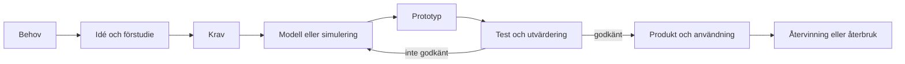

# Kapitel 1: Teknikutveckling och projektarbete

> **I det här kapitlet lär du dig**
> - hur teknikutvecklingsprocessen hänger ihop från behov till återvinning
> - hur du gör om ett löst behov till krav som går att mäta
> - hur du planerar ett projekt med mål, delmoment, tidsplan och roller
> - varför testning och omtag är en normal del av arbetet, inte ett misslyckande

Tänk dig en robotdammsugare som fastnar under soffan varje dag. Någon har designat den, köpt komponenter, skrivit programvara, testat den och bestämt vilka fel som är acceptabla. Ändå blev det inte perfekt. Teknikutveckling handlar sällan om att få en genial idé och bygga den rakt av. Det handlar om att arbeta sig fram med mätningar, modeller och omtag, och om att veta varför man väljer som man gör.

I den här kursen gör du flera projekt som går hela vägen från idé till något som fungerar. Det här kapitlet ger dig arbetssättet som du använder i alla projekten.

## Teknikutvecklingsprocessen

**Teknikutvecklingsprocessen** är ett sätt att beskriva stegen från ett behov till en färdig produkt eller tjänst. Stegen ser lite olika ut i olika företag, men idéerna är desamma.

Lägg märke till pilen tillbaka. Ett test som underkänner prototypen är inte ett misslyckat projekt. Testet har gett dig information som du inte hade innan. Att gå tillbaka kallas **iteration**, och det är oftast billigast att göra det tidigt, medan felet finns i en simulering eller en CAD-modell i stället för i en färdig produkt.

Det sista steget, återvinning, glöms ofta bort. Men de val du gör i början, till exempel om delar är limmade eller skruvade, avgör om produkten går att reparera och ta isär senare. Därför hör hållbarhet hemma redan i kravställningen.

### Så samverkar stegen

| Steg | Exempel från robotmoppen | Vad påverkar nästa steg |
|---|---|---|
| Behov | En golvyta ska bli täckt utan att någon styr bilen | Avgör vad som alls är värt att bygga |
| Krav | Täckningen ska mätas i ett rutnät med 64 rutor | Bestämmer vad testet ska mäta |
| Modell | Städprogrammet körs i simulatorn turtlesim | Hittar logiska fel billigt |
| Prototyp | Bil, chassi, penna och sensorer sätts ihop | Visar det som simuleringen inte fångar |
| Test | Körningar på arenan enligt mätprotokoll | Ger underlag för att ändra modell eller konstruktion |

## Från behov till mätbara krav

Ett **krav** är något som lösningen måste uppfylla. Ett bra krav går att testa: efteråt ska du kunna säga ja eller nej, gärna med en siffra. Det brukar kallas att kravet är **verifierbart**.

### Genomgånget exempel: krav för en robotmopp

Utgå från behovet "bilen ska städa arenan bra". Det går inte att testa. Vad är "bra"? Vi gör om det steg för steg.

1. **Vad ska hända?** Bilen ska täcka golvytan med ett pennspår.
2. **Hur mäter vi det?** Arenan är 2 × 2 m och delas i ett rutnät med 8 × 8 rutor, alltså 64 rutor. En ruta räknas som täckt om den har pennspår.
3. **Hur beräknar vi resultatet?** Täckning = rutor med spår / alla rutor.
4. **Under vilka villkor?** Samma arena, och ett bestämt tidstak, till exempel 3 minuter.

Om bilen kommer åt 58 rutor blir täckningen 58 / 64 = 0,906, alltså ungefär 91 %. Nu kan du jämföra två program med varandra på ett rättvist sätt.

Skillnaden i tabellform:

| Vagt | Verifierbart |
|---|---|
| Bilen ska städa bra | Minst 58 av 64 rutor ska ha pennspår efter 3 minuter |
| Bilen ska inte krocka | Högst 2 väggkontakter per körning |
| Bilen ska vara stabil | Bilen klarar hela mätprotokollet utan att pennan lossnar |

Kraven får gärna delas in i **ska-krav**, som måste uppfyllas, och **bör-krav**, som ger plus om de uppfylls. Siffrorna i tabellen är exempel. I varje projekt finns det krav som läraren har bestämt, och utöver dem kan du sätta egna krav som passar din lösning.

## Projektmetodik

Ett **projekt** är ett tidsbegränsat arbete med ett bestämt mål. Eftersom tiden är begränsad måste du prioritera, och prioriteringar blir bättre om de är nedskrivna.

### Projektplanen

En användbar projektplan svarar på sex frågor:

| Fråga | I projektplanen |
|---|---|
| Vad ska vi åstadkomma? | Mål och avgränsningar |
| Hur vet vi att vi lyckats? | Krav och testmetod |
| Vad består arbetet av? | Delmoment, ofta kallat arbetsnedbrytning |
| I vilken ordning och när? | Tidsplan med milstolpar |
| Vem gör vad? | Roller och ansvar |
| Vad kan gå fel? | Risklista, se [kapitel 6](06-kvalitet-och-risk.md) |

En **milstolpe** är en punkt där något ska vara klart och kontrollerat, till exempel "bilen kör via ROS2 på en låda". Bra milstolpar går att visa upp, inte bara att bocka av.

### Komponentlista

I ett projekt med hårdvara är **komponentlistan** en av de viktigaste delarna av planen. Den ska inte bara räkna upp saker. Den ska också säga varför en del behövs, vad den kräver av övriga delar och var den ska sitta.

| Komponent | Funktion | Mått och krav som påverkar konstruktionen |
|---|---|---|
| ESP8266 | Tar emot kommandon, styr motor och servo | Mät kortet, plats för kablar och USB |
| Motor | Driver bilen | Hur den fästs, avstånd till hjulaxeln |
| Servo | Styr hjulen | Utslag åt båda håll utan att ta i chassit |
| HC-SR04 | Mäter avstånd framåt | Fri sikt framåt, rätt höjd över golvet |
| Ljussensor | Känner av ljust eller mörkt golv | Riktad mot golvet, skyddad från ströljus |
| Penna | Ritar spår | Fjädrande fäste så att spetsen når golvet |

Att skriva listan innan du börjar med CAD sparar tid. Annars upptäcker du för sent att servot inte får plats.

### Arbetsformer

Ingen metod passar alla projekt. Två vanliga sätt att tänka är:

- **Stegvis planering**, ibland kallad vattenfall. Allt planeras i förväg och görs i en bestämd ordning. Det passar när kraven är kända och misstag är dyra, till exempel när något ska tillverkas i hög serie.
- **Iterativt arbete**, till exempel agila metoder. Arbetet delas i korta perioder som var och en ger något som går att testa. Det passar när du inte vet från början vad som fungerar, till exempel i programvara och prototyper.

I skolprojekt blandar du ofta: en tydlig plan för helheten och korta iterationer i det tekniska arbetet.

### Dokumentera medan du arbetar

Skriv en **projektlogg** löpande: vad du gjorde, vad som hände, vad du ändrade och varför. Mätvärden skrivs ned direkt med enhet och förutsättningar. Det tar några minuter per lektion och gör att rapporten i slutet nästan skriver sig själv. I [kapitel 10](10-entreprenorskap-och-kommunikation.md) går vi igenom hur du gör en rapport av materialet.

### Rollerna i en grupp

När ni arbetar flera tillsammans behöver ansvaret vara tydligt, annars gör två personer samma sak medan något annat inte blir gjort alls. Roller kan vara till exempel konstruktionsansvarig, programvaruansvarig, test- och mätansvarig och dokumentationsansvarig. Roller betyder inte att andra inte får hjälpa till. De betyder att någon känner ansvar för att just den delen blir färdig. Tänk också på att fördela roller medvetet: det är lätt att de praktiska och de skrivande uppgifterna fastnar hos samma personer varje gång.

## Begrepp

- **Teknikutvecklingsprocess:** stegen från behov till produkt, användning och återvinning.
- **Iteration:** att gå tillbaka och förbättra efter test.
- **Krav:** något som lösningen måste uppfylla. Bra krav är verifierbara.
- **Verifierbart krav:** ett krav som går att kontrollera med test eller mätning.
- **Arbetsnedbrytning:** att dela upp projektet i hanterbara delmoment.
- **Milstolpe:** en punkt i tidsplanen där ett delresultat ska vara klart.
- **Projektlogg:** löpande anteckningar om vad som gjorts och varför.
- **Agilt arbete:** arbete i korta perioder som var och en ger något som går att testa.

## Koppling till projektet

Arbetssättet används i alla projekt. Tydligast syns det i [Robotmopp](../projekt/robotmopp/README.md), där du börjar med projektplan och komponentlista, och i [MikroGrid](../projekt/mikrogrid/README.md), där dimensionering och verifiering av krav står i centrum. I [Laserskär](../projekt/laserskar/README.md) går du igenom hela kedjan i liten skala.

## Läs mer

- [Skolverket om ämnet teknik](https://www.skolverket.se)
- [Robotmoppens labbserie i ROS2-repot](https://github.com/abbjetmus/ROS2)

[Innehåll](../README.md) | [Nästa →](02-material.md)
