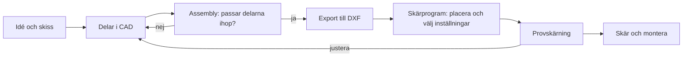

# Kapitel 3: Digitala ritningar, CAD och laserskärning

> **I det här kapitlet lär du dig**
> - hur du läser en teknisk ritning och vad som skiljer ritning från modell
> - hur en CAD-modell med delar och en sammanställning hjälper dig att hitta fel tidigt
> - hur du räknar med skärbredden när en del ska passa i en annan
> - hur du anpassar en konstruktion efter tillverkningsmetoden

Att designa något som ser bra ut på skärmen är en sak. Att få två träbitar att sitta ihop utan lim är något annat. Skillnaden mellan modell och verklighet kan vara bråkdelar av en millimeter, och den skillnaden bestämmer om bitarna glappar, sitter perfekt eller inte går ihop alls. Det här kapitlet handlar om hur du tolkar och skapar digitala underlag så att det du ritar faktiskt går att tillverka.

## Ritningar och modeller

En **CAD-modell** (Computer Aided Design) är en digital beskrivning av ett föremål, oftast i 3D. En **ritning** är ett dokument som beskriver föremålet med vyer, mått och anteckningar, så att någon annan kan tillverka det utan att fråga. Ritningar är ett språk med regler, och därför går de att läsa i hela världen.

| Del av ritningen | Vad den berättar |
|---|---|
| Vyer (framifrån, från sidan, uppifrån) | Formen från olika håll |
| Måttlinjer | Storlek, vanligen i millimeter |
| Skala | Hur stor bilden är jämfört med föremålet |
| Tolerans | Hur mycket ett mått får avvika |
| Snitt | Hur föremålet ser ut inuti |
| Ritningshuvud | Namn, material, skala, version |

**Skala** läses som bild:verklighet. I skala 1:2 är bilden hälften så stor som föremålet. En längd som är 30 mm på ritningen är alltså 60 mm i verkligheten. Rita aldrig av mått genom att mäta med linjal på en ritning, utan läs de angivna måtten.

**Tolerans** är hur stort fel som kan accepteras. Inget tillverkas exakt. Ett hål kan till exempel anges som 3,0 ± 0,1 mm, och det betyder att allt från 2,9 till 3,1 mm är godkänt. Ju snävare tolerans, desto dyrare tillverkning.

### Parametriska modeller

I program som Autodesk Inventor bygger du delar med **skisser** och **features**, till exempel extrudering. Modellen är **parametrisk**, vilket betyder att måtten är värden som kan ändras. Om du lägger materialets tjocklek i en parameter behöver du bara ändra på ett ställe när skivan visar sig vara tunnare än väntat.

### Sammanställning

En **assembly** (sammanställning) är en modell där flera delar sätts ihop med villkor. Där upptäcker du om delar krockar med varandra och om måtten stämmer. Det är mycket billigare att flytta en slits i CAD än att skära en ny skiva. Det gäller både mobilhållaren och robotens chassi, där motorn, servot och kretskortet måste få plats samtidigt.

För laserskärning exporterar du delarna till **DXF**, ett 2D-format med linjer som maskinens program kan läsa.

## Från CAD till fysisk del

**Provskärningen** är det steget som oftast hoppas över, och det är ofta det som ger bäst resultat. En liten testbit med några slitsar i olika bredd visar precis vad din maskin och ditt material gör.

## Skärbredd

En laserskärare bränner bort material längs linjen. Det material som försvinner kallas **skärbredd** (på engelska *kerf*). I projektbeskrivningen till Laserskär anges att laserskäraren tar bort ungefär 0,15 mm material. I det här kapitlet räknar vi det som skärets hela bredd och att skäret ligger centrerat på linjen. Verkligheten kan avvika, och därför mäter du alltid på en provskärning.

Eftersom skäret ligger mitt på linjen flyttas varje kant halva skärbredden åt det håll som tar bort material:

- En **tapp** (en del som sticker ut) blir **smalare**.
- En **slits** eller ett hål blir **bredare**.

Med skärbredden k blir verkligt mått:

- tapp: verkligt mått = ritat mått − k
- slits: verkligt mått = ritat mått + k

### Genomräknat exempel: tapp i slits

Du ritar en tapp och en slits, båda 3,00 mm breda, med skärbredden 0,15 mm.

- Verklig tapp: 3,00 − 0,15 = 2,85 mm
- Verklig slits: 3,00 + 0,15 = 3,15 mm
- Glapp: 3,15 − 2,85 = 0,30 mm

Delarna hamnar alltså löst i varandra trots att måtten såg rätt ut i CAD.

Anta nu att du vill ha en slits som är exakt 3,00 mm bred för skivans tjocklek. Rita då slitsen 3,00 − 0,15 = 2,85 mm. Slitsen blir efter skärning 2,85 + 0,15 = 3,00 mm. Vill du samtidigt ha en tapp som är exakt 20,00 mm bred, ritar du den 20,00 + 0,15 = 20,15 mm.

Tjockleken är också ett mått du ska mäta. En skiva som kallas 3 mm kan vara lite tunnare eller tjockare. Mät med skjutmått, använd det uppmätta värdet och justera sedan efter provbiten. För **presspassning**, där delarna hålls ihop av friktion, ska slitsen vara ytterst lite mindre än tappen. Hur mycket beror på träet och fukten.

Varje konstruktion får olika slitsar och tappar, och därför kan du inte använda samma kompensation överallt. Ett praktiskt sätt är att lägga tjocklek och skärbredd som parametrar och beräkna alla slitsar därifrån.

## Att konstruera för laserskärning

Att anpassa konstruktionen efter hur den ska tillverkas kallas **tillverkningsanpassad konstruktion**. För laserskuren plywood eller annan tunn träskiva gäller till exempel följande:

- **Fibrerna.** Ytskikten i en skiva har en fiberriktning. En smal tapp som går tvärs fibrerna går lättare av. Lägg långa smala delar längs fibrerna.
- **Inga skarpa inre hörn** där en spricka kan börja. Runda av hörn som belastas.
- **Tillräckligt material runt slitsar.** En slits nära en kant gör att kanten bryts av.
- **Skärprogrammet.** Inre detaljer ska skäras före yttre konturen, så att delen inte flyttar sig under skärningen.
- **Materialutnyttjande.** Placera delarna tätt i ett arbetsark.

### Säkerhet vid laserskärning

Laserskärning ger rök och heta partiklar. Följ alltid lärarens genomgång. Generellt gäller att maskinen inte får lämnas obevakad under skärning och att ventilationen ska vara igång. Skär bara material som läraren har godkänt, eftersom en del plaster, till exempel PVC, avger farliga gaser när de bränns.

## Begrepp

- **CAD:** datorstödd konstruktion.
- **Ritning:** dokument med vyer, mått och anteckningar.
- **Skala:** förhållandet mellan bildens och föremålets storlek.
- **Tolerans:** hur mycket ett mått får avvika.
- **Parametrisk modell:** modell vars mått kan ändras som värden.
- **Assembly:** sammanställning av flera delar.
- **DXF:** filformat för 2D-geometri.
- **Skärbredd (kerf):** den bredd laserskäret tar bort.
- **Presspassning:** delar som hålls ihop av friktion.

## Testa dig själv

1. Vad är skillnaden mellan en CAD-modell och en ritning?
2. Varför ska du inte mäta på en ritning med linjal?
3. Varför blir en laserskuren tapp mindre än det ritade måttet?
4. Varför sätter man upp en provskärning innan man skär slutversionen?
5. Hur hjälper en assembly dig att hitta fel tidigt?
6. Varför ska smala delar läggas längs fiberriktningen?
7. Varför är det viktigt att mäta skivans tjocklek?

## Övningar

**Grund.** En ritning har skala 1:5, och en längd är 40 mm på ritningen. Hur lång är den i verkligheten?

Svar

40 · 5 = 200 mm.

**Grund.** Du mäter skivans tjocklek till 2,90 mm. Skärbredden är 0,15 mm. Vilken bredd ska du rita slitsen för att den ska bli lika bred som skivan är tjock?

Svar

2,90 − 0,15 = 2,75 mm. Efter skärning: 2,75 + 0,15 = 2,90 mm.

**Vidare.** Du ska få plats med delar på ett A4-ark (210 × 297 mm). Delarna är 120 × 80 mm, två stycken 90 × 60 mm samt 120 × 40 mm. Hur stor andel av arket används? Föreslå hur du placerar delarna.

Svar

Arket: 210 · 297 = 62 370 mm². Delarna: 9 600 + 2 · 5 400 + 4 800 = 25 200 mm². Andel: 25 200 / 62 370 ≈ 0,40, alltså cirka 40 %.

**Utmaning.** Konstruera en liten provbit med fem slitsar vars bredd skiljer sig 0,05 mm åt. Skär den och använd resultatet för att bestämma din maskins och din skivas bästa slitsbredd.

## Koppling till projektet

I [Laserskär](../projekt/laserskar/README.md) använder du allt från det här kapitlet: delar i Inventor, assembly, kompensation för skärbredd och DXF-export. Samma tänkande om mått och monteringsbarhet använder du när du ritar chassit i [Robotmopp](../projekt/robotmopp/README.md).

## Läs mer

- [Projektbeskrivning Laserskär (docx)](https://github.com/abbindustrigymnasium/Konstruktion1/blob/main/Lasersk%C3%A4r%20mobil%20och%20pennh%C3%A5llare.docx)
- [Svenska institutet för standarder (SIS)](https://www.sis.se/)

[← Föregående](02-material.md) | [Innehåll](../README.md) | [Nästa →](04-elektronik.md)
