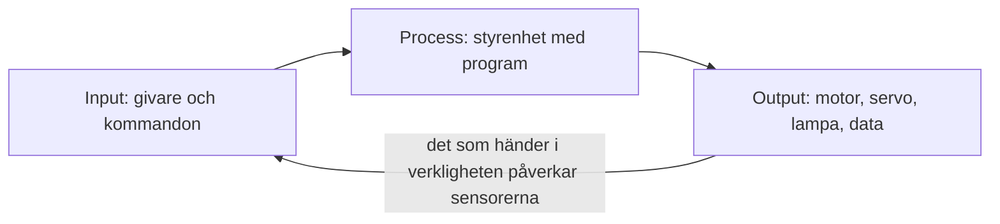

# Kapitel 4: Elektronik som styr och reglerar

> **I det här kapitlet lär du dig**
> - skillnaden mellan elektricitet och elektronik
> - hur du beskriver ett system med input, process och output
> - hur spänning, ström, resistans och effekt hänger ihop
> - hur spänningsdelare, PWM och ultraljudsmätning fungerar
> - varför elektronik behövs för att styra och reglera

Ett lysrör och en mobiltelefon drivs båda av elektricitet. Lysröret är bara på eller av, medan mobilen fattar miljontals beslut varje sekund. Det är skillnaden mellan att använda el som energi och att använda el som information. Moderna maskiner använder båda delarna: elektriciteten driver motorn, och elektroniken avgör när och hur.

## Elektricitet och elektronik

**Elektricitet** handlar om laddningar i rörelse och om energi som överförs. **Elektronik** är kretsar som använder små strömmar och spänningar för att behandla information och styra större effekter. Den viktigaste byggstenen är **transistorn**, en halvledarkomponent som fungerar som en styrbar ventil. Forskarna bakom den belönades med [Nobelpriset i fysik 1956](https://www.nobelprize.org/prizes/physics/1956/summary/). Dagens mikrokontroller innehåller väldigt många transistorer, och därför kan en liten krets köra program och läsa av sensorer.

## Input, process, output

Du kan beskriva nästan varje styrt system med tre delar.



| Del | Vad den gör | Exempel i robotmoppen |
|---|---|---|
| **Input** | Omvandlar något i världen till en signal | HC-SR04 mäter avstånd, ljussensorn ser golvet |
| **Process** | Bestämmer vad som ska hända | ESP8266 och dina ROS2-noder |
| **Output** | Påverkar världen | Motorn, servot, data till datorn |

En termostat, en bil och ett värmesystem fungerar enligt samma mönster.

### Styrning och reglering

**Styrning** innebär att ett kommando skickas utan att systemet kontrollerar resultatet. **Reglering** innebär att systemet mäter resultatet och rättar till skillnaden mot det önskade värdet. Det kallas att det finns **återkoppling**.

| | Styrning | Reglering |
|---|---|---|
| Exempel | Köra motorn med en bestämd PWM i 5 sekunder | Mäta avståndet och bromsa in innan väggen |
| Återkoppling | Nej | Ja |
| Klarar störningar | Dåligt: batteriet och underlaget ändrar resultatet | Bättre: felet mäts och rättas |

Varför behövs elektronik för det här? Man skulle kunna bygga en mekanisk reglering. Äldre ångmaskiner hade mekaniska regulatorer. Men elektroniken gör att regeln går att ändra med programkod, att sensorvärden kan bearbetas och att beslut går att fatta tusentals gånger per sekund. Den kan också kommunicera med andra system, och det är sådant en mekanisk lösning inte klarar. Elektroniken får tala om vad som ska hända, medan en motor och en drivkrets ger kraften.

### Genomräknat exempel: enkel reglering

Vid mjuk inbromsning kan bilens fart beräknas så här:

```
fart = min(0.4, K * (avstånd - 0.30))
```

Med K = 2 ger det:

| Avstånd | Beräkning | Fart |
|---|---|---|
| 0,50 m | 2 · 0,20 = 0,40 | 0,40 |
| 0,40 m | 2 · 0,10 = 0,20 | 0,20 |
| 0,32 m | 2 · 0,02 = 0,04 | 0,04 |

Farten sjunker alltså när bilen närmar sig målet. Det kallas **proportionell reglering**. Är K för stort hinner bilen inte bromsa och kan pendla, är K för litet kommer den aldrig riktigt fram.

## Grundstorheter

| Storhet | Tecken | Enhet | Betydelse |
|---|---|---|---|
| Spänning | U | volt (V) | Hur hårt laddningarna drivs |
| Ström | I | ampere (A) | Hur mycket laddning som passerar per sekund |
| Resistans | R | ohm (Ω) | Hur mycket komponenten bromsar strömmen |
| Effekt | P | watt (W) | Hur mycket energi som omvandlas per sekund |

**Ohms lag** är U = R · I. **Effekten** är P = U · I.

Tänk på att ström och spänning inte är samma sak. En spänningskälla kan ha "tryck" men ändå inte kunna leverera mycket ström.

### Genomräknat exempel: lysdiod

En lysdiod (LED) med spänningsfall 2,0 V ska lysa med ungefär 10 mA på en 3,3 V-utgång. Resistorn ska ta hand om resten av spänningen:

U_R = 3,3 − 2,0 = 1,3 V

R = U / I = 1,3 V / 0,010 A = 130 Ω

Närmaste vanliga värde uppåt är 150 Ω. Då blir strömmen I = 1,3 / 150 ≈ 8,7 mA. Lysdioden lyser ändå bra, och utgången belastas lite mindre.

## Sensorer och spänningsdelare

Många sensorer ändrar sin resistans, och mikrokontrollern kan bara läsa av spänning. Lösningen är en **spänningsdelare**, två resistanser i serie där spänningen delas i proportion till storleken:

```
U_ut = U_in · R2 / (R1 + R2)
```

### Genomräknat exempel: ljussensor

En **LDR** är ett motstånd vars resistans minskar när det blir ljusare. Anta att LDR sitter som R1 mot 3,3 V och att R2 är 10 kΩ. Anta också att ingången A0 mäter 0–3,3 V och ger värden 0–1023. (Den finns ofta på utvecklingskort med ESP8266, men kontrollera ditt kort, eftersom ingången på själva chipet har ett mindre spänningsområde.)

| Fall | LDR | U_ut | Avläst värde |
|---|---|---|---|
| Ljust papper | 2 kΩ | 3,3 · 10 / 12 = 2,75 V | 2,75 / 3,3 · 1023 ≈ 853 |
| Mörkt streck | 20 kΩ | 3,3 · 10 / 30 = 1,10 V | 1,10 / 3,3 · 1023 = 341 |

Skillnaden mellan värdena är stor, och du kan välja en tröskel mellan dem. LDR-värdena är exempel. Du måste själv mäta vad din sensor ger på rätt papper.

## Avståndsmätning med ultraljud

HC-SR04 sänder en ljudpuls och mäter tiden tills ekot kommer tillbaka. Ljudet färdas till hindret och tillbaka, så avståndet är halva vägen. Ljudets hastighet är ungefär 340 m/s, vilket är 0,034 cm/µs.

**Exempel.** Ekot tar 1 750 µs. Avståndet är

d = 1 750 · 0,034 / 2 ≈ 29,8 cm.

HC-SR04 drivs ofta med 5 V, och utsignalen får då också spänningen 5 V. ESP8266-ingångarna är avsedda för 3,3 V. Kontrollera därför hur sensorn ska kopplas i din krets. En spänningsdelare med 1 kΩ och 2 kΩ sänker 5 V till 5 · 2 / 3 ≈ 3,3 V. Fråga läraren om du är osäker innan du kopplar in spänningen.

## PWM: att styra effekt

En digital utgång kan bara vara hög eller låg. Med **PWM** (pulsbreddsmodulering) slås utgången på och av snabbt, och den andel av tiden som utgången är hög kallas **duty cycle**. Genomsnittseffekten till motorn blir på så sätt inställbar.

I firmware går hastigheten från −1023 till 1023. Värdet 600 ger duty cycle 600 / 1023 ≈ 59 %. Med 6 V matning till motordrivaren är medelspänningen ungefär 0,59 · 6 ≈ 3,5 V. En ESP8266 kan inte driva motorn direkt, så en **motordrivare** behövs mellan processorn och motorn. Den får små signaler in och kopplar stora strömmar ut.

Vad en PWM-procent ger i meter per sekund beror på motor, batteri och underlag. Därför måste bilens fart mätas.

## Säkerhet i elektronikarbete

- Bygg med spänningen frånkopplad, och kontrollera polariteten innan du kopplar in.
- Kortslutning av ett batteri kan ge stora strömmar och brandrisk. Se [kapitel 6](06-kvalitet-och-risk.md).
- Sänk risken genom att mäta på varje del innan allt kopplas ihop.

## Begrepp

- **Elektronik:** kretsar som behandlar signaler och information.
- **Transistor:** halvledarkomponent som styr en ström med en annan signal.
- **Input, process, output:** givare, beslut och påverkan.
- **Styrning:** kommando utan kontroll av resultat.
- **Reglering:** mätning av resultatet och korrigering av skillnaden.
- **Återkoppling:** det uppmätta resultatet används i styrningen.
- **Ohms lag:** U = R · I.
- **Spänningsdelare:** två resistanser som delar en spänning.
- **PWM:** snabb på- och avslagning som ger en inställbar genomsnittseffekt.
- **Motordrivare:** krets mellan styrsignal och motor.

## Testa dig själv

1. Vad är skillnaden mellan elektricitet och elektronik?
2. Beskriv en mikrovågsugn med input, process och output.
3. Vad är skillnaden mellan styrning och reglering? Ge ett eget exempel på vardera.
4. Varför delas tiden med 2 när ultraljudet används för att mäta avstånd?
5. Varför behövs en spänningsdelare när du läser av en LDR?
6. Varför kan inte mikrokontrollern driva motorn direkt?
7. Varför säger en PWM-procent inte hur fort bilen kör?
8. Varför behövs elektronik för att reglera en robot, när det finns mekaniska regulatorer?

## Övningar

**Grund.** En resistor på 330 Ω har 3,3 V över sig. Hur stor är strömmen?

<details><summary>Svar</summary>

I = U / R = 3,3 / 330 = 0,010 A = 10 mA.

</details>

**Grund.** Ekot tar 1 000 µs. Hur långt bort är hindret?

<details><summary>Svar</summary>

1 000 · 0,034 / 2 = 17 cm.

</details>

**Vidare.** Hastighetsvärdet är 300 av 1023 och matningen är 6 V. Beräkna duty cycle och medelspänning.

<details><summary>Svar</summary>

300 / 1023 ≈ 29 %. Medelspänningen är ungefär 0,29 · 6 ≈ 1,8 V.

</details>

**Vidare.** Rita upp robotmoppen som ett input-process-output-diagram. Märk vilka signaler som är analoga och vilka som är digitala.

**Utmaning.** LDR-värdet är 4 kΩ i ljust och 15 kΩ i mörkt läge med R2 = 10 kΩ och 3,3 V. Beräkna avläst värde i båda lägen (0–1023 för 0–3,3 V) och föreslå en tröskel. Motivera varför du inte lägger tröskeln precis vid det ena värdet.

<details><summary>Svar</summary>

Ljust: 3,3 · 10 / 14 ≈ 2,36 V, vilket ger cirka 731. Mörkt: 3,3 · 10 / 25 = 1,32 V, vilket ger cirka 409. En tröskel runt mitten (cirka 570) ger marginal åt båda hållen om ljuset eller golvet varierar.

</details>

## Koppling till projektet

I [Robotmopp](../projekt/robotmopp/README.md) är bilen just ett sådant system: givare, program, motor och servo. Labb 9 och 10 kräver att du förstår spänningsdelaren, PWM och ultraljudet. I [MikroGrid](../projekt/mikrogrid/README.md) arbetar du med effekt, spänning och ström på energisidan, och där mäter du i kretsen för att verifiera dina beräkningar.

## Läs mer

- [Nobelpriset i fysik 1956 om transistorn](https://www.nobelprize.org/prizes/physics/1956/summary/)
- [Espressif om ESP8266](https://www.espressif.com/en/products/socs/esp8266)

[← Föregående](03-cad-och-laserskarning.md) | [Innehåll](../README.md) | [Nästa →](05-modeller-och-programmering.md)
