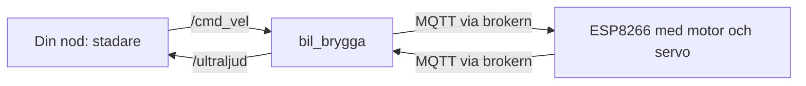
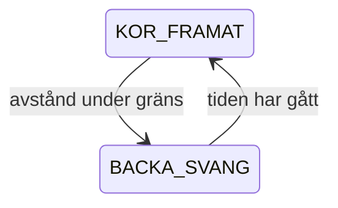

# Kapitel 5: Modeller, simulering och programmering

> **I det här kapitlet lär du dig**
> - vad en modell är, vad den kan och vad den inte kan
> - hur ROS2 delar upp ett robotprogram i noder och topics
> - hur en MQTT-brygga kopplar ihop ROS2 med en mikrokontroller
> - hur en tillståndsmaskin styr beteenden
> - hur du gör rimlighetsbedömningar med enkla beräkningar

En bugg i simuleringen kostar en omstart. En bugg på golvet kostar en krockad bil. Det är huvudskälet till att professionella robotbyggare testar sina program i simulering först. Men simuleringen är alltid en förenkling, och det svåra är att veta vad den inte visar.

## Vad är en modell?

En **modell** är en förenklad beskrivning av något verkligt som hjälper dig att förstå eller förutsäga det. En CAD-modell beskriver form. En ekvation som d = v · t beskriver rörelse. **Simulering** innebär att du låter en modell köra över tid och ser vad som händer.

| Fråga | Svar i robotmoppen |
|---|---|
| Vad förenklar modellen? | Sköldpaddan i turtlesim vet exakt var den är och kan svänga på stället |
| Vad är den bra för? | Att testa logik, strategier och programflöde utan risk |
| Vad visar den inte? | Sensorbrus, fördröjning, hjulglidning, en motor som inte orkar |

Bra arbete med modeller består av att **validera**, det vill säga jämföra modellen med verkligheten och justera den.

## ROS2: robotens program i delar

**ROS2** (Robot Operating System) är ett ramverk för robotprogram, inte ett operativsystem i vanlig mening. Det delar upp programmet i **noder**, små program som gör en sak var. Noder pratar med varandra via **topics**, namngivna kanaler där meddelanden skickas. En nod som skickar är en **publisher**, och en nod som lyssnar är en **subscriber**.



Fördelen är att du kan byta ut en del utan att ändra de andra. Samma kod som styr sköldpaddan kan styra en bil, bara topics och sensorer byts.

### ROS2 och mikrokontrollern

ROS2 körs inte på en ESP8266, som är för liten. Istället körs ROS2 på din dator och bilen får bli en sorts drivrutin. Datorn och bilen pratar via **MQTT**, ett lättviktigt protokoll där enheter publicerar och prenumererar på meddelanden via en central server som kallas **broker**. Du använder den broker som läraren anger. Adress och eventuella inloggningsuppgifter får du av läraren. Lägg aldrig in lösenord i ett publikt repo.

**Bryggnoden** översätter mellan ROS2 och MQTT. Dina noder behöver då inte veta något om MQTT alls. Firmware på bilen lyssnar efter kommandon som består av hastighet och vinkel. Bilen skickar sin avståndsmätning tillbaka. Om inget kommando kommit på en halv sekund stannar motorn. Det kallas **dödmansgrepp**, en säkerhetsfunktion som ligger i bilen eftersom den måste fungera även om nätverket går ned.

## Tillståndsmaskiner

En **tillståndsmaskin** är ett sätt att beskriva ett beteende: systemet är alltid i ett tillstånd, och vissa händelser gör att det byter tillstånd. Bilen kan inte svänga på stället, eftersom servot bara vrider framhjulen och bilen måste rulla för att ändra riktning. Därför används två tillstånd.



### Genomgånget exempel: tillståndsmaskin i Python

Det här är en förenklad version utan ROS2, som går att köra direkt.

```python
KOR_FRAMAT = "kor_framat"
BACKA_SVANG = "backa_svang"
STOPP_AVSTAND = 0.30
BACKA_TICKS = 3   # antal tidssteg som bilen backar

def steg(tillstand, ticks, avstand):
    """Returnerar nytt tillstånd, ticks kvar att backa och utsignal (fart, sväng)."""
    if tillstand == KOR_FRAMAT and avstand < STOPP_AVSTAND:
        tillstand, ticks = BACKA_SVANG, BACKA_TICKS
    if tillstand == BACKA_SVANG:
        if ticks > 0:
            return tillstand, ticks - 1, (-0.4, 1.0)
        tillstand = KOR_FRAMAT
    return tillstand, ticks, (0.4, 0.0)

tillstand, ticks = KOR_FRAMAT, 0
for avstand in [1.2, 0.8, 0.28, 0.5, 0.9, 1.1, 1.3]:
    tillstand, ticks, utsignal = steg(tillstand, ticks, avstand)
    print(f"{avstand:4.2f} m  {tillstand:12s} {utsignal}")
```

När du kör programmet ser du att bilen vid 0,28 m går över till att backa i tre steg, även om sensorn sedan ser längre bort, och därefter fortsätter framåt. Så fungerar den riktiga noden också, men där styrs tiden av en klocka och signalerna går via ROS2.

## Mäta täckning

Hur vet programmet vilka rutor som har besökts? Dela arenan i ett rutnät och räkna ut vilken ruta en position hör till:

```python
RUTOR = 8
ARENA = 11.0

def ruta(x, y):
    kolumn = min(RUTOR - 1, max(0, int(x / ARENA * RUTOR)))
    rad = min(RUTOR - 1, max(0, int(y / ARENA * RUTOR)))
    return (rad, kolumn)

besokta = set()
for x, y in [(1.0, 1.0), (1.2, 1.1), (5.5, 1.0), (7.2, 3.1), (11.0, 11.0)]:
    besokta.add(ruta(x, y))

print(sorted(besokta))
print(f"Täckning: {len(besokta)}/{RUTOR * RUTOR} rutor")
```

Utskriften visar fyra rutor, eftersom de två första punkterna hamnar i samma ruta. `min` och `max` ser till att (11,0; 11,0) hamnar i sista rutan i stället för att hamna utanför rutnätet.

## Från simulering till verklighet

Turtlesims värld är 11 × 11 enheter och arenan är 2 × 2 m. Skalfaktorn är k = 2,0 / 11 ≈ 0,18 m per enhet.

**Genomräknat exempel.** En marginal på 1,5 enheter motsvarar 1,5 · 0,18 ≈ 0,27 m. Farten 2,0 enheter/s motsvarar 2,0 · 0,18 ≈ 0,36 m/s.

Längder går att översätta rakt av. Bilens fart måste däremot mätas, eftersom den beror på batteri och underlag. Hur fort bilen svänger beror på farten och hjulvinkeln, inte bara på ett värde i koden.

## Rimlighetsbedömning

Innan du kör, gör en grov beräkning och fråga dig om resultatet är rimligt.

**Bromsning.** Med 200 ms fördröjning i nätverket och 0,4 m/s hinner bilen 0,4 · 0,2 = 0,08 m, alltså 8 cm, innan stoppkommandot ens börjar verka. Då kan inte stoppgränsen vara hur liten som helst.

**Täckning.** Hur lång tid tar 2 × 2 m om allt går perfekt? Med 25 cm mellan raderna blir det 8 raka sträckor på 2 m och 7 korta förflyttningar på 0,25 m:

8 · 2 + 7 · 0,25 = 17,75 m

Vid 0,36 m/s tar det 17,75 / 0,36 ≈ 49 sekunder. Det är den bästa tänkbara tiden. Om din bil vid den farten tar 40 sekunder har du mätt fel, och en verklig bil med svängar och backningar behöver mycket längre tid. Slumpstädning är ännu långsammare, eftersom bilen kör där den redan har varit.

## Begrepp

- **Modell:** förenklad beskrivning av något verkligt.
- **Simulering:** en modell som körs över tid.
- **Validering:** jämförelse mellan modell och verklighet.
- **Nod:** ett program i ett ROS2-system.
- **Topic:** namngiven kanal för meddelanden.
- **Publisher och subscriber:** nod som skickar och nod som lyssnar.
- **MQTT:** lättviktigt meddelandeprotokoll.
- **Broker:** server som förmedlar MQTT-meddelanden.
- **Brygga:** program som översätter mellan två system.
- **Dödmansgrepp:** funktion som stoppar maskinen om kommandon uteblir.
- **Tillståndsmaskin:** beteende uppdelat i tillstånd och övergångar.

## Koppling till projektet

Kapitlet är grunden för [Robotmopp](../projekt/robotmopp/README.md). Labb 8 gör simuleringen, labb 9 kopplar ROS2 till bilen via bryggan, och labb 10 flyttar städlogiken till golvet och jämför resultaten med simuleringen.

## Läs mer

- [ROS2-labbarna](https://github.com/abbjetmus/ROS2)
- [Officiell ROS2-dokumentation](https://docs.ros.org/en/jazzy/)
- [Eclipse Mosquitto om MQTT](https://mosquitto.org/man/mqtt-7.html)

[← Föregående](04-elektronik.md) | [Innehåll](../README.md) | [Nästa →](06-kvalitet-och-risk.md)
