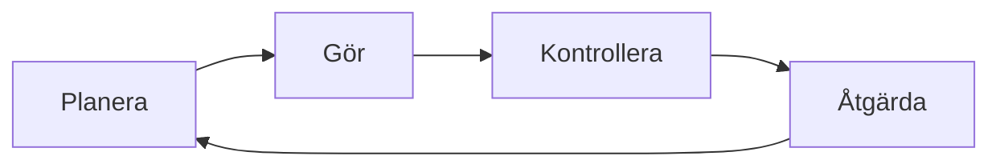

# Kapitel 6: Mätning, kvalitet, risk och arbetsmiljö

> **I det här kapitlet lär du dig**
> - hur systematiskt kvalitetsarbete går till
> - hur du planerar tester och tar hand om mätdata
> - hur du gör en riskanalys
> - hur miljösäkring och arbetsmiljö hänger ihop med tekniska projekt

Tänk dig att din robot klarar ett test. Vet du då att den fungerar? Nej, du vet att den fungerade en gång. Kvalitet betyder att du kan lita på resultatet, att du kan visa varför och att felen hittas och rättas systematiskt. Samma sak gäller allt från ett lödställe till en fabrik.

## Systematiskt kvalitetsarbete

**Kvalitetssäkring** är det du gör för att fel inte ska uppstå eller för att de ska hittas innan produkten lämnar dig. Ett vanligt sätt att arbeta är **PDCA**, som står för Plan, Do, Check och Act.

Arbetet blir systematiskt när samma steg följs varje gång och när resultatet dokumenteras. Företag använder ofta standarder för det. **ISO 9001** handlar om ledningssystem för kvalitet och **ISO 14001** om ledningssystem för miljö. I Sverige är [SIS](https://www.sis.se/) organisationen som ger ut standarder. Vad en organisation använder varierar, men principen om att mäta, följa upp och förbättra är densamma.

### Testplan och mätprotokoll

Ett test är bara användbart om du i förväg vet vad som ska mätas och vad som är godkänt. Då kan du jämföra resultaten. Ett **mätprotokoll** bestämmer till exempel:

1. Vad som mäts, med vilken enhet och vilket instrument.
2. Under vilka förhållanden.
3. Hur många gånger det ska göras.
4. Vad som räknas som godkänt.

Ändra **en sak i taget**. Om du ändrar både stopp-avstånd och fart och resultatet blir bättre vet du inte vad som hjälpte.

### Genomräknat exempel: mätvärden med fel

Du mäter ett avstånd på 30 cm fem gånger och får 29,8, 30,1, 29,7, 30,4 och 58,2 cm.

- **Medelvärde:** (29,8 + 30,1 + 29,7 + 30,4 + 58,2) / 5 = 35,64 cm
- **Median**, det mittersta värdet efter sortering: 30,1 cm

En enda felaktig mätning drar upp medelvärdet med flera centimeter, men medianen påverkas knappt. Därför används ofta ett **medianfilter** på ultraljudsmätningar. Men släng inte automatiskt avvikande värden i en rapport. Ta reda på varför de uppstod och redovisa vad du gjort.

### Mätosäkerhet

Inga mätningar är exakta. Skriv rimligt antal decimaler. Om en multimeter visar 3,284 V i en krets där spänningen pendlar är det inte meningsfullt att redovisa alla siffror. Ange också vilket instrument du använt och fundera över om själva mätningen kan påverka resultatet.

## Riskanalys

**Risk** väger samman hur sannolikt något är och hur allvarligt det skulle bli. En **riskanalys** identifierar vad som kan gå fel, bedömer det och bestämmer åtgärder.

### Riskmatris

Ett enkelt sätt är att ge sannolikhet och konsekvens betyg från 1 till 5 och multiplicera.

| Risk | Sannolikhet | Konsekvens | Risktal | Åtgärd |
|---|---|---|---|---|
| Kortslutning vid batteri | 2 | 5 | 10 | Isolering, säkring, kontroll innan inkoppling |
| Bilen krockar med vägg | 4 | 3 | 12 | Stoppavstånd, lägre fart, medianfilter |

Bilen har högst risktal, men det betyder inte att krocken är det viktigaste att åtgärda. En händelse med liten sannolikhet men allvarlig konsekvens, till exempel brand, måste behandlas med respekt oavsett risktalet. Därför använder du både siffrorna och ditt omdöme.

### FMEA

**FMEA** (Failure Mode and Effects Analysis, felsätts- och effektanalys) går igenom varje del och frågar hur den kan gå sönder. Varje felsätt ges värden för allvarlighet (S), sannolikhet (O) och hur svårt felet är att upptäcka (D). Produkten kallas RPN.

| Del | Felsätt | S | O | D | RPN |
|---|---|---|---|---|---|
| Servo | Fastnar | 8 | 3 | 4 | 96 |
| Ultraljud | Felaktigt värde | 5 | 6 | 5 | 150 |
| Batterikabel | Lossnar | 9 | 2 | 3 | 54 |

Beräkningen av ultraljudsraden är 5 · 6 · 5 = 150. Det som har högst RPN åtgärdas först, och sedan görs analysen om. Även här krävs omdöme, eftersom ett fel med hög allvarlighetsgrad sällan kan få vänta.

## Miljösäkring

**Miljösäkring** innebär att miljöpåverkan hanteras som en del av arbetet. I ett projekt kan det handla om att:

- planera för minimalt spill, till exempel vid laserskärning,
- välja material som går att återvinna,
- lämna batterier och elektronik till rätt insamling,
- dokumentera vad som har använts, så att någon kan ta hand om det efteråt.

I [kapitel 9](09-livscykelanalys-och-varden.md) går vi igenom hur miljöpåverkan bedöms i ett större perspektiv.

## Arbetsmiljö

**Arbetsmiljö** handlar om att människor inte ska bli sjuka eller skadas av sitt arbete. [Arbetsmiljöverket](https://www.av.se/arbetsmiljoarbete-och-inspektioner/arbeta-med-arbetsmiljon/systematiskt-arbetsmiljoarbete-sam/) beskriver det **systematiska arbetsmiljöarbetet** som en pågående process där arbetsgivaren undersöker arbetsförhållanden, bedömer risker, åtgärdar dem och följer upp. Reglerna ändras med tiden, så kontrollera myndighetens webbplats om du behöver aktuella krav.

I kursens projekt kan frågorna gälla:

| Moment | Risk | Skydd |
|---|---|---|
| Laserskärning | Rök, brand | Ventilation, aldrig obevakad, godkända material |
| Lödning | Rök, brännskador | Punktutsug, skyddsglasögon, ställ för lödkolven |
| Litiumbatterier | Brand vid kortslutning eller skada | Följa lärarens instruktioner, kontrollera kopplingen, laddning under uppsikt |
| Långvarigt skärmarbete | Belastningsbesvär | Pauser, ställ in stol och skärm |
| Arbete i grupp | Stress vid tidspress | Realistisk plan, tydliga roller |

### Litiumbatterier

Litiumbatterier innehåller mycket energi i liten volym. Vid kortslutning, mekanisk skada eller felaktig laddning kan de överhettas och börja brinna. Det kan även bildas giftiga gaser, och en brand kan vara svår att släcka. Använd bara laddare som är avsedda för din batterityp. Undersök battericeller innan du använder dem, och lägg dem åt sidan om de är skadade eller svullna. Följ alltid lärarens genomgång för hantering, laddning och förvaring.

## Begrepp

- **Kvalitetssäkring:** arbete som förebygger och upptäcker fel.
- **PDCA:** Planera, Gör, Kontrollera, Åtgärda.
- **Mätprotokoll:** regler för hur ett test genomförs och dokumenteras.
- **Median:** mittersta värdet i en sorterad lista.
- **Medianfilter:** beräkning som dämpar enstaka felaktiga värden.
- **Risk:** sammanvägning av sannolikhet och konsekvens.
- **FMEA:** metod som går igenom hur varje del kan fallera.
- **Miljösäkring:** att hantera miljöpåverkan som en del av arbetet.
- **Systematiskt arbetsmiljöarbete:** att undersöka, bedöma, åtgärda och följa upp risker i arbetet.

## Koppling till projektet

I [Robotmopp](../projekt/robotmopp/README.md) följer du ett mätprotokoll på arenan och jämför körningar. I [MikroGrid](../projekt/mikrogrid/README.md) ingår en enkel riskanalys för batterihantering och kvalitetssäkring genom belastningstester. I [Databaser och mobil apputveckling](../projekt/databaser-och-mobilapp/README.md) tillämpar du samma tänkande på testning av regler och funktioner.

## Läs mer

- [Arbetsmiljöverket om systematiskt arbetsmiljöarbete](https://www.av.se/arbetsmiljoarbete-och-inspektioner/arbeta-med-arbetsmiljon/systematiskt-arbetsmiljoarbete-sam/)
- [SIS, Svenska institutet för standarder](https://www.sis.se/)

[← Föregående](05-modeller-och-programmering.md) | [Innehåll](../README.md) | [Nästa →](07-databaser-och-digitalisering.md)
