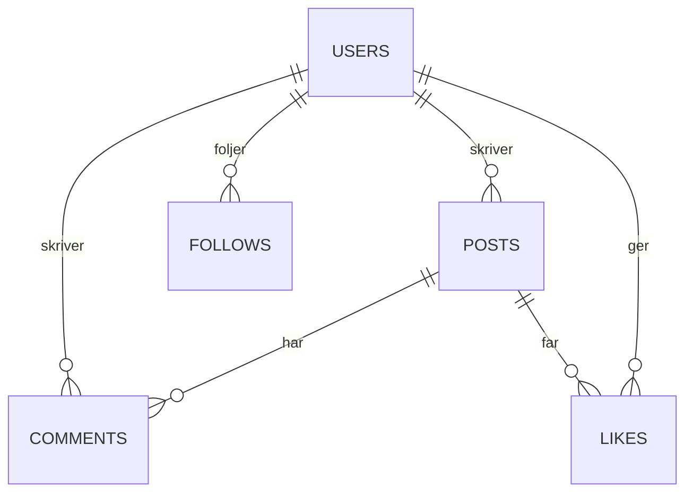
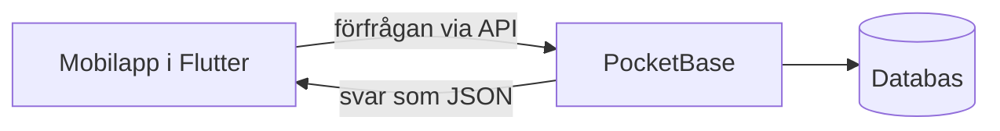

# Kapitel 7: Databaser, appar och digitalisering

> **I det här kapitlet lär du dig**
> - vad en relationsdatabas är och hur du designar en
> - hur tabeller kopplas ihop med relationer
> - hur en app, ett API och en databas samverkar
> - hur säkerhet och personuppgifter påverkar din lösning
> - hur digitaliseringen förändrar produktion, kommunikation och vår livsmiljö

Varje gång du gillar ett inlägg skapas en liten rad i en databas någonstans. I raden står vem du är, vilket inlägg det gäller och när det hände. Sådana små rader gör det möjligt för appen att visa ditt flöde, räkna gillningar och komma ihåg vem du följer. Att kunna utforma data är en grundläggande färdighet för alla som bygger digitala tjänster.

## Vad är en databas?

En **databas** är en organiserad samling data som flera program kan läsa och ändra på ett säkert sätt. I en **relationsdatabas** ligger data i tabeller. Varje rad är en post, och varje kolumn är ett fält med en bestämd typ, till exempel text, tal, datum eller ja/nej.

Viktiga begrepp:

- **Primärnyckel** är ett fält som unikt pekar ut en rad, till exempel `id`.
- **Främmande nyckel** är ett fält som hänvisar till en rad i en annan tabell.
- En **relation** är en koppling mellan tabeller.

## Designa en databas

Ett enkelt arbetssätt:

1. Beskriv vad systemet ska göra, med några meningar.
2. Stryk under substantiven. Om det finns många av något och de har egna uppgifter blir det en tabell.
3. Bestäm fält och typer.
4. Rita relationerna.
5. Testa designen med påhittade data och några frågor som systemet ska kunna besvara.

### Genomgånget exempel: Kvittra

Kvittra är en enkel social app där användare skriver inlägg, kommenterar, gillar och följer varandra.



| Relation | Typ | Så löses den |
|---|---|---|
| En användare skriver många inlägg | 1:N | `posts.author` pekar på `users` |
| Ett inlägg har många kommentarer | 1:N | `comments.post` pekar på `posts` |
| Användare gillar inlägg | N:M | Egen kopplingstabell `likes` |
| Användare följer användare | N:M mot samma tabell | Egen tabell `follows` |

Varför kan vi inte bara lägga ett fält "gillningar" med en lista av namn i `posts`? För att vi då skulle få svårt att söka, att förhindra dubbletter och att ta bort en gillning. Därför finns `likes` som egen tabell, och den har en **unik kombination** av inlägg och användare: samma person kan bara gilla ett inlägg en gång.

Att lagra varje uppgift på bara ett ställe kallas **normalisering**. Om en användare byter namn behöver du då bara ändra på ett ställe.

### Frågor med SQL

**SQL** är språket som används för att ställa frågor till relationsdatabaser. Den här frågan visar varje inlägg, vem som skrev det och hur många gillningar det har:

```sql
SELECT posts.title, users.username, COUNT(likes.id) AS antal_likes
FROM posts
JOIN users ON users.id = posts.author
LEFT JOIN likes ON likes.post = posts.id
GROUP BY posts.id
ORDER BY antal_likes DESC;
```

`JOIN` kopplar ihop tabeller. `LEFT JOIN` gör att inlägg utan gillningar också kommer med, med värdet 0. Testa alltid frågan med data du känner till och kontrollera resultatet för hand.

### En rimlighetsbedömning

Hur stor blir databasen? Om 200 användare skriver 30 inlägg var, och varje rad tar ungefär 1 kB, blir det 200 · 30 · 1 kB = 6 000 kB, alltså ungefär 6 MB. Det är litet för en dator. Bilder och video kräver mycket mer, så de hanteras oftast som filer utanför tabellerna.

## Från databas till app



**PocketBase** är en backend, alltså programvaran på serversidan, som innehåller en databas, användarinloggning och ett färdigt **API**. Ett API är de bestämda sätt som ett program kan be ett annat om data. **Flutter** är ett ramverk för att bygga appar i språket **Dart**. I Flutter byggs gränssnittet av widgets, små återanvändbara delar, och appens **state** är de data som kan ändras och som styr vad som visas.

## Säkerhet och behörighet

Att appen kan läsa en tabell betyder inte att alla ska kunna göra det. **API-regler** bestämmer vem som får lista, läsa, skapa, ändra och ta bort poster. Ett vanligt krav är att bara författaren får ändra sitt inlägg. I PocketBase kan det skrivas som `author = @request.auth.id`.

Var särskilt försiktig med en tom regel, eftersom den i PocketBase ger tillgång till alla, även dem som inte är inloggade. Lägg aldrig lösenord och hemliga nycklar i publik kod.

## Personuppgifter

Så snart du lagrar uppgifter som kan kopplas till en person hanterar du **personuppgifter**. **GDPR**, EU:s dataskyddsförordning, sätter ramarna för detta. På [Integritetsskyddsmyndighetens webbplats](https://www.imy.se/verksamhet/dataskydd/det-har-galler-enligt-gdpr/) kan du läsa vad som gäller. Grundprincipen i teknikarbete är **dataminimering**: samla bara in det du faktiskt behöver. Fundera också över hur länge uppgifterna ska sparas och hur en användare kan få dem borttagna.

## Digitaliseringens betydelse

**Digitalisering** innebär att information och arbetssätt görs digitala, och att det leder till nya sätt att arbeta och leva.

| Område | Möjligheter | Frågor att väga in |
|---|---|---|
| **Produktion** | Sensorer, robotar och datainsamling ger snabbare omställning och mindre spill | Jobb som förändras, sårbarhet vid driftstopp och cyberattacker |
| **Kommunikation** | Vi kan nå varandra och dela information snabbt | Desinformation, utanförskap för dem som saknar uppkoppling eller digital vana |
| **Livsmiljö** | Styrning av värme och energi, tjänster på distans | Övervakning, energi- och materialanvändning i datacenter och elektronik |

Digitalisering är inte automatiskt bra eller dålig. Vem som vinner och förlorar beror på hur lösningen utformas och används.

## Begrepp

- **Databas:** organiserad samling data.
- **Relationsdatabas:** databas med tabeller och relationer.
- **Primärnyckel:** unik identitet för en rad.
- **Främmande nyckel:** fält som pekar på en rad i en annan tabell.
- **N:M-relation:** många till många, ofta löst med kopplingstabell.
- **Normalisering:** varje uppgift lagras på ett ställe.
- **SQL:** språk för att ställa frågor till relationsdatabaser.
- **API:** bestämt sätt för program att kommunicera.
- **Backend:** programvaran på serversidan.
- **Widget:** byggdel för gränssnitt i Flutter.
- **State:** data som kan ändras och styr vad som visas.
- **Personuppgift:** uppgift som kan kopplas till en person.
- **Dataminimering:** att bara samla in det som behövs.

## Testa dig själv

1. Vad är skillnaden mellan primärnyckel och främmande nyckel?
2. Varför behövs en kopplingstabell för N:M-relationer?
3. Varför är det dåligt att spara samma uppgift på flera ställen?
4. Vad händer om en API-regel är tom?
5. Varför ska frågor testas med data du känner till?
6. Vad innebär dataminimering? Ge ett exempel.
7. Vilka två fördelar och två risker ser du med digitalisering i en fabrik?

## Övningar

**Grund.** Identifiera tabeller, fält och relationer för en app där elever bokar en tid hos en handledare.

**Grund.** Hur stor blir en tabell med 5 000 rader om varje rad tar 2 kB?

<details><summary>Svar</summary>

5 000 · 2 kB = 10 000 kB, alltså ungefär 10 MB.

</details>

**Vidare.** Skriv API-regler i ord för ett bokningssystem: vem får se, skapa, ändra och ta bort en bokning?

**Vidare.** Skriv en SQL-fråga som räknar antal kommentarer per inlägg.

**Utmaning.** Du ska utveckla en tjänst som samlar platsdata från en elevs mobil för att mäta skolvägar. Beskriv vilka personuppgifter som samlas in, vad du skulle minimera och vilka etiska problem som uppstår. Föreslå ett alternativ som kräver mindre data.

## Koppling till projektet

I [Databaser och mobil apputveckling](../projekt/databaser-och-mobilapp/README.md) designar du databasen för ert förstudieprojekt, bygger Kvittra i PocketBase och gör en Flutter-app som pratar med den. Kapitlets modell med tabeller, relationer och regler använder du direkt.

## Läs mer

- [Kursmaterial för PocketBase och Flutter](https://github.com/abbjetmus/pocketbase-flutter-kurs)
- [PocketBase dokumentation](https://pocketbase.io/docs/)
- [Flutter dokumentation](https://docs.flutter.dev/)
- [Integritetsskyddsmyndigheten om GDPR](https://www.imy.se/verksamhet/dataskydd/det-har-galler-enligt-gdpr/)

[← Föregående](06-kvalitet-och-risk.md) | [Innehåll](../README.md) | [Nästa →](08-solenergi-och-batterier.md)
