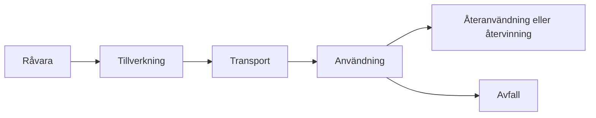

# Kapitel 9: Livscykelanalys, hållbarhet och etik

> **I det här kapitlet lär du dig**
> - hur en livscykelanalys går till och vad en funktionell enhet är
> - hur du jämför tekniska lösningar utifrån miljö, ekonomi och människor
> - vad cirkulär ekonomi innebär
> - hur genus och etik påverkar vilka tekniska lösningar som blir bra
> - hur du värderar framtidens teknik utan att bli varken naiv eller cynisk

Solpaneler ger el utan utsläpp medan de är i drift. Men de tillverkas av kisel som smälts i energikrävande processer. Batterierna kräver metaller som bryts på platser där arbetsförhållandena ibland är farliga. Är solenergi ändå bra? Svaret på en sådan fråga är sällan bara ja eller nej. Det är "bra jämfört med vad, för vem och under vilka förutsättningar?". För att kunna svara behöver du verktyg.

## Livscykelanalys

En **livscykelanalys** (LCA) bedömer miljöpåverkan från en produkt under hela dess liv. Standarderna ISO 14040 och ISO 14044 beskriver hur det ska göras.

En LCA består av fyra delar:

1. **Mål och omfattning**: vad jämförs, och var dras gränserna?
2. **Inventering**: vilka material, energi och utsläpp hör till varje steg?
3. **Miljöpåverkansbedömning**: vad innebär flödena för klimat, försurning, vatten och så vidare?
4. **Tolkning**: vilka slutsatser håller, och vad är osäkert?

### Funktionell enhet

För att jämförelsen ska vara rättvis måste du jämföra samma nytta. Den **funktionella enheten** beskriver vilken nytta du jämför. Ett exempel är "belysning av en plats i ett år".

### Genomräknat exempel

Två utomhuslampor jämförs. Siffrorna nedan är påhittade för räkneexemplet.

| | Lampa A | Lampa B |
|---|---|---|
| Utsläpp vid tillverkning | 3,0 kg CO₂e | 2,0 kg CO₂e |
| Livslängd | 5 år | 2 år |

Funktionell enhet: ett års belysning.

- Lampa A: 3,0 / 5 = 0,6 kg CO₂e per år
- Lampa B: 2,0 / 2 = 1,0 kg CO₂e per år

Trots att lampa A ger större utsläpp att tillverka är den bättre per år, eftersom den håller längre. Antag att A behöver ett nytt batteri, som ger 0,5 kg CO₂e, efter halva tiden. Då blir utsläppen (3,0 + 0,5) / 5 = 0,7 kg CO₂e per år. Lampa A är fortfarande bättre. Slutsatsen beror på antagandena, så de ska alltid redovisas.

## Solenergi i ett livscykelperspektiv

Tillverkning av solpaneler kräver kisel av mycket hög renhet, och det gör smältningen till en av de mest energikrävande delarna i kedjan. Men panelerna producerar sedan el under lång tid. Ett mått som används är **energiåterbetalningstid**, alltså hur länge systemet behöver producera för att ge tillbaka den energi som gick åt för att tillverka det. Enligt [Fraunhofer ISE](https://www.ise.fraunhofer.de/en/publications/studies/photovoltaics-report.html) ligger den för kiselbaserade system på ungefär ett år på Sicilien. Den beror på solinstrålning och teknik, så den är längre där det är mindre sol. Om ett system håller i 20 år med återbetalningstid på ett år ger det omkring 20 gånger mer energi än det krävde.

## Batterimetaller

Litiumbatterier kan innehålla litium, nickel, mangan, kobolt eller järn och fosfat, beroende på kemi. Alla batterier är alltså inte likadana. Några frågor att granska:

- **Var bryts metallerna?** Enligt [USGS](https://pubs.usgs.gov/periodicals/mcs2026/mcs2026-cobalt.pdf) kommer drygt 70 % av världens gruvbrutna kobolt från Kongo-Kinshasa. Stor koncentration till ett land innebär geopolitiska risker.
- **Under vilka villkor?** Det amerikanska arbetsmarknadsdepartementet har [rapporterat om barnarbete](https://www.dol.gov/agencies/ilab/reports/child-labor/list-of-goods) inom småskalig koboltbrytning. Kongo har invänt mot delar av bedömningen, så det finns anledning att läsa källorna kritiskt.
- **Vad händer efteråt?** [EU:s batteriförordning](https://eur-lex.europa.eu/eli/reg/2023/1542/oj) ställer krav på bland annat insamling och återvinning. **Mekanisk återvinning** innebär att batterier sönderdelas, och **hydrometallurgisk återvinning** att metallerna löses ut med vätskor. Båda kräver energi och kemikalier.

Att granska en värdekedja innebär inte att säga nej till batterier. Det innebär att kräva spårbarhet, bättre villkor och konstruktioner där cellen går att byta.

## Cirkulär ekonomi

I en **linjär ekonomi** tillverkas, används och slängs produkter. I en **cirkulär ekonomi** behålls material och produkter i användning så länge som möjligt. [Ellen MacArthur Foundation](https://www.ellenmacarthurfoundation.org/topics/circular-economy-introduction/overview) beskriver målen som att minska avfall och föroreningar, cirkulera material och regenerera naturen.

Det påverkar konstruktionen på flera sätt: batterier ska gå att byta, sammanfogningar ska gå att öppna, och produkten ska gå att reparera. Det ger också nya **affärsmodeller**, till exempel att sälja en funktion i stället för en produkt, leasing eller återköp. Ett företag som äger produkterna kan tjäna på att de håller länge.

## Etik och genus i teknikutveckling

**Etik** handlar om vad som är rätt att göra, och vem som bär konsekvenserna. Tekniska val är ofta också etiska val, till exempel vad som ska prioriteras när kostnaden ska sänkas.

**Genus** handlar om hur föreställningar om kön formar samhället. Teknik utvecklas av människor, och deras antaganden följer med in i produkten. Ett tydligt exempel kommer från trafiksäkerhet. [Chalmers](https://www.chalmers.se/aktuellt/nyheter/alumnpris-battre-varld-2026-hon-utmanar-normerna-for-trafiksakerhet/) beskriver hur forskaren Astrid Linder visade att kvinnor haft sämre skydd mot whiplashskador och hur en krockdocka baserad på en genomsnittlig kvinna togs fram. Om bara ett slags kropp används när något testas riskerar lösningen att bli sämre för andra.

Frågor att ställa till en lösning:

| Aspekt | Frågor |
|---|---|
| Genus och användare | Vems kropp, vems vana och vems behov användes som utgångspunkt? |
| Etik | Vem får nyttan, vem bär risken, vem bestämde? |
| Tillgänglighet | Vem kan inte använda lösningen, och varför? |
| Ekologi | Vilka resurser och vilket avfall? |
| Ekonomi | Hur mycket kostar den, och vem betalar? |

## Framtidens teknik

Den tekniska utvecklingen rör sig snabbt. Solceller med nya halvledarmaterial, batterier med annan kemi och AI-baserad styrning av energi är områden som ofta nämns. Var nyfiken, men också kritisk. Skilj på sådant som är demonstrerat, sådant som testas i pilotprojekt och sådant som finns i stor skala. Fråga alltid vem som säger vad och vilken data som visas. Tekniken och samhället formar varandra: lagar, ekonomi och människors vanor avgör vad som slår igenom, och tekniken förändrar i sin tur lagar, ekonomi och vanor.

## Begrepp

- **Livscykelanalys (LCA):** bedömning av miljöpåverkan under hela produktens liv.
- **Funktionell enhet:** den nytta som jämförs.
- **Systemgräns:** vad som räknas med i analysen.
- **CO₂e:** koldioxidekvivalenter, ett sätt att väga samman växthusgaser.
- **Energiåterbetalningstid:** tiden tills energin som gick åt har producerats.
- **Cirkulär ekonomi:** material och produkter behålls i användning.
- **Hydrometallurgi:** utvinning av metaller med vätskor.
- **Genus:** föreställningar om kön och hur de formar samhället.

## Testa dig själv

1. Varför behövs en funktionell enhet?
2. Vilka fyra delar består en LCA av?
3. Varför kan en produkt med högre tillverkningsutsläpp ändå vara bättre?
4. Vad är energiåterbetalningstid och vad beror den på?
5. Varför är det viktigt att läsa källor om koboltbrytning kritiskt?
6. Hur kan konstruktionen göra en produkt mer cirkulär?
7. Ge ett eget exempel på hur antaganden om användare kan göra en produkt sämre för vissa.
8. Hur skiljer du på demonstrerad teknik och teknik i stor skala?

## Övningar

**Grund.** Lampa C ger 4,0 kg CO₂e vid tillverkningen och håller i 8 år. Beräkna utsläppen per år.

Svar

4,0 / 8 = 0,5 kg CO₂e per år.

**Grund.** Ett solsystem har energiåterbetalningstid 1,5 år och livslängd 25 år. Hur många gånger mer energi ger det än det krävde?

Svar

25 / 1,5 ≈ 16,7, alltså ungefär 17 gånger.

**Vidare.** Gör en förenklad LCA för en vattenflaska, och välj en funktionell enhet. Vilka steg är viktigast? Vilka uppgifter saknas?

**Vidare.** Välj en produkt du använder och gå igenom tabellen ovan. Föreslå en förändring.

**Utmaning.** Jämför två sätt att driva en sensornod: engångsbatterier eller litiumbatteri med solpanel. Bestäm funktionell enhet, ta reda på uppgifter från pålitliga källor och redovisa vad som är osäkert.

## Koppling till projektet

I fas 4 av [MikroGrid](../projekt/mikrogrid/README.md) ska du göra en analys av solenergisystemets värdekedja, från råvara till återvinning, och väga miljövinster mot sociala och etiska frågor. Med tankesättet från kapitlet går det också att granska [Robotmopp](../projekt/robotmopp/README.md) och [Laserskär](../projekt/laserskar/README.md).

## Läs mer

- [Fraunhofer ISE Photovoltaics Report](https://www.ise.fraunhofer.de/en/publications/studies/photovoltaics-report.html)
- [IEA om kritiska mineral](https://www.iea.org/reports/the-role-of-critical-minerals-in-clean-energy-transitions)
- [USGS om kobolt](https://pubs.usgs.gov/periodicals/mcs2026/mcs2026-cobalt.pdf)
- [EU:s batteriförordning](https://eur-lex.europa.eu/eli/reg/2023/1542/oj)
- [Ellen MacArthur Foundation om cirkulär ekonomi](https://www.ellenmacarthurfoundation.org/topics/circular-economy-introduction/overview)

[← Föregående](08-solenergi-och-batterier.md) | [Innehåll](../README.md) | [Nästa →](10-entreprenorskap-och-kommunikation.md)
